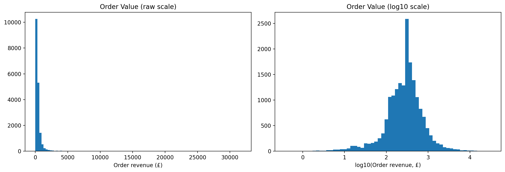
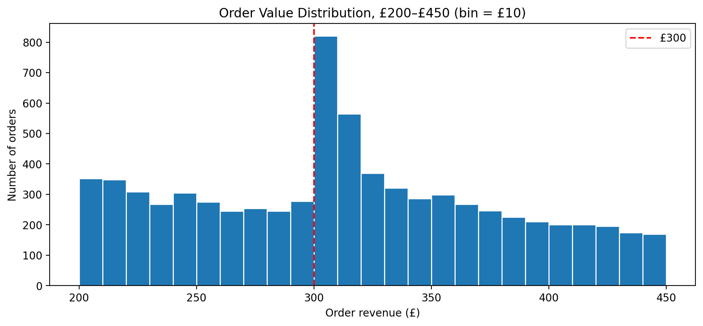
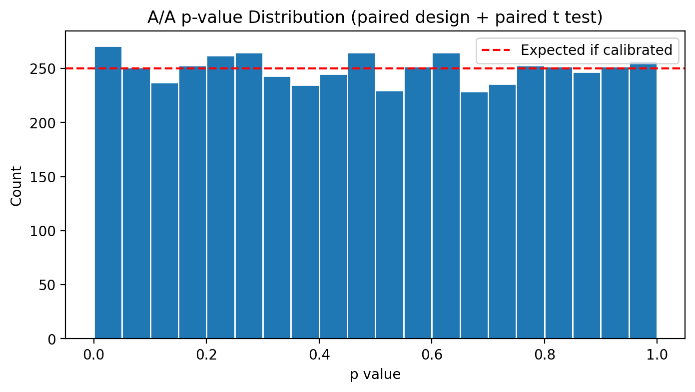

## Experiment Design Document

Raising the Free Shipping Threshold from £300 to £400

### TL, DR

- **Question:** Would raising the free-shipping threshold from £300 to £400 increase revenue per customer?
- **Feasibility:** With  about 2,800 eligible customers, even the best design (matched pairs + winsorization +
  CUPED) can only reliably detect lifts of **~25% in 4 weeks**. A realistic effect is approcimately 5%, for which power
  is only approximately 10%.
- **Recommendation:** Do **not** run a standard A/B test aimed at proving a revenue lift. Instead, clarify
  the business goal. If it is cost reduction, evaluate margin under a non inferiority framework, and
  launch via a staged rollout to lower-risk customers with pre-defined rollback criteria.

---

### 1. Background

- Order values show strong bunching just above £300: the £300–310 bin has approxiamtely 3 times more orders than neighboring bins. This suggests the existing threshold, free shipping, has already changes customer behavior.
- The proposal is to raise the threshold to £400, either to encourage larger baskets or to reduce shipping
  costs absorbed by the company.

### 2. Hypotheses

- **Primary (superiority):** H₀: revenue per customer is unchanged; H₁: it differs (two-sided).
- **Alternative (non-inferiority), if the goal is cost reduction:** H₀: revenue per customer falls by more
  than an acceptable margin (e.g. 2%); H₁: any decline is within the margin, while margin per customer
  improves.

### 3. Metrics

| Type                | Metric                                              | Rationale                                                         |
| ------------------- | --------------------------------------------------- | ----------------------------------------------------------------- |
| **Primary**   | Net revenue per customer over the experiment window | Reflects the business goal; not fooled by order consolidation     |
| Secondary           | Average order value; orders per customer            | Explain *how* revenue changes (bigger baskets vs. fewer orders) |
| Secondary           | Share of orders ≥ £400                            | Directly measures threshold-chasing behavior; more sensitive      |
| Secondary           | Purchase rate                                       | Detects customers who stop buying                                 |
| **Guardrail** | Margin per customer after shipping costs            | Revenue gains must not come at a loss                             |
| **Guardrail** | Cancellation rate                                   | Detects buyer's remorse from padded orders                        |
| **Guardrail** | Activity of top-tier customers                      | Revenue is highly concentrated; losing key accounts is costly     |

**Why not AOV as the primary metric:** a customer who replaces three £100 orders with one £250 order
raises AOV by 150% while spending less in total.

### 4. Population and Randomization

- **Unit:** customer, for a consistent experience and independence of observations.
- **Eligible population:** customers with ≥ 1 purchase in the 6 months before launch (about 2,800). Fixed before
  launch so it cannot be affected by treatment. Non buyers during the window are count as £0.
- **New customers:** new consumers are excluded from the primary analysis (no pre-period data). If included, they form a separate stratum, defined only by information available at assignment.
- **Assignment:** **matched pairs** on pre period revenue. Reenue is highly concentrated on top 1% of customers
  , accounts for 41% of revenue, and simulation showed decile stratification fails to balance them because all top
  customers sit in one decile. Matched pairs split them evenly every time.

### 5. Analysis Plan

- **Primary analysis:** paired t-test on net revenue **winsorized at p99** (cap from pooled data) and
  **CUPED adjusted** using pre period revenue (also winsorized at p99).
- **Sensitivity analyses:** unwinsorized revenue, winsorization at p95.
- **Pre specified segments:** top tier vs. other customers. Any further slicing is exploratory and
  corrected for multiple comparisons.
- **α = 0.05, two-sided.** Duration and sample size fixed in advance, no early stopping based on interim
  results, no peeking.
- **Validity checks before reading results:** SRM check, assignment/exposure consistency.

### 6. Power and Duration

| Approach                          | 4-week MDE     | 12-week MDE |
| --------------------------------- | -------------- | ----------- |
| Simple randomization, raw revenue | 78%            | 53%         |
| Winsorized p99 + CUPED (formula)  | 20%            | 13%         |
| Final design (simulation)         | **~25%** | —          |

- Variance reduction lowers the MDE 3–5 times, but the plausible effect (~5%) remains far below it.
- Formula based MDEs are optimistic: winsorization dilutes part of the true lift. Simulation on historical
  data is the more realistic estimate.
- Longer windows help only modestly because the population is fixed, and windows beyond about 12 weeks run into the holiday season.

### 7. Validation

- **A/A simulation (5,000 runs):** the final design has a false positive rate of 5.4%, within the Monte Carlo
  band of [4.4%, 5.6%], with uniformly distributed p values.
- **Order level analysis must be avoided:** randomizing by customer but testing at the order level gave a
  **33%** false positive rate, because orders from the same customer are correlated.

### 8. Risks

- **Irreversibility:** shipping policy is visible to customers, therefore changing it back and forth erodes trust,
  and wholesale customers who leave are hard to win back.
- **Concentration:** a handful of customers drive most revenue, their reaction could dominate both the
  result and the business impact.
- **Seasonality:** results from a holiday window would not generalize to the rest of the year.

### 9. Recommendation

1. **Do not run a standard superiority A/B test** on revenue: it is very unlikely to detect a realistic
   effect, and a non significant result would be uninformative.
2. **Clarify the goal with the product team.** If the motive is reducing shipping costs, use **margin per
   customer** as the primary metric with a **non-inferiority** test on revenue.
3. **If launching, use a staged rollout:** start with lower risk (non top tier) customers, keep the current
   threshold for key accounts, and set **rollback criteria** in advance for example, decline in purchase rate or in
   top-tier customer activity beyond a set level).
4. **Track the more sensitive secondary metric** , like share of orders ≥ £400 to confirm the threshold changes
   behavior as intended.

### 10. Limitations of This Analysis

- Based on historical simulation, actual behavior under a new threshold may differ.
- The existing £300 threshold is inferred from bunching. The data contain no direct shipping policy or
  shipping cost information, so margin could not be estimated.
- No site visit data: the population is limited to past purchasers, so effects on new customer acquisition
  are not covered.

